# Установка #

1. 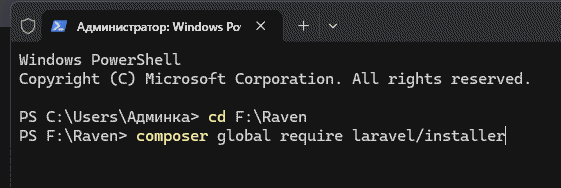

2. 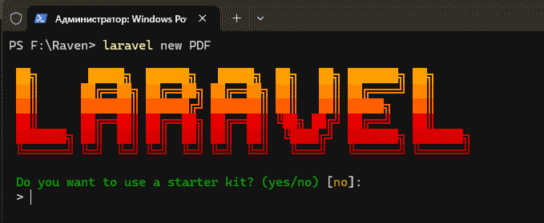

3. No

4. 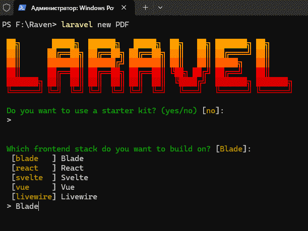

5. Blade

6. 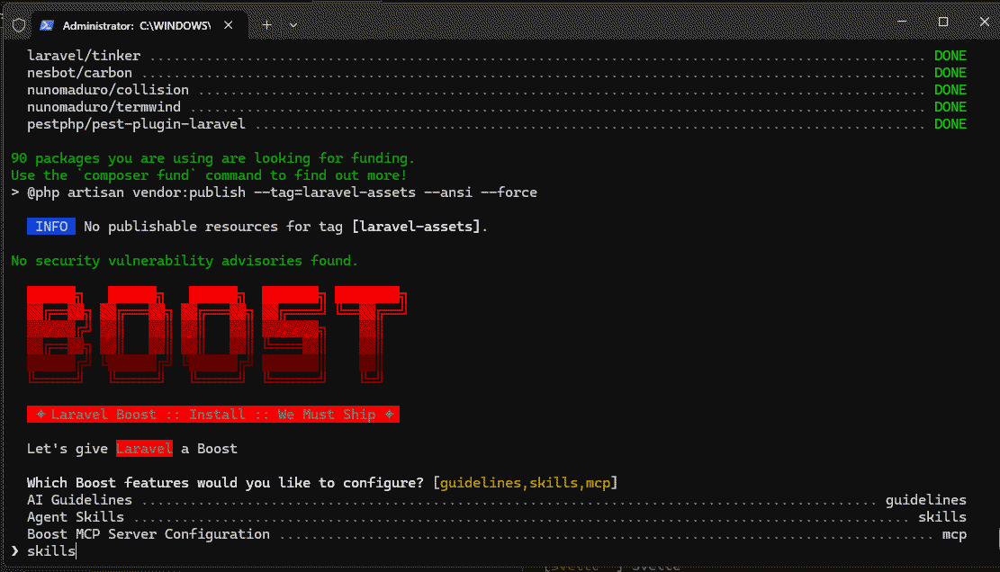

7. skills

8. 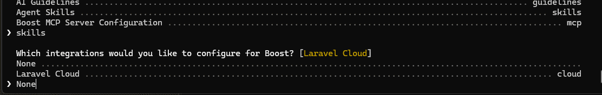

9. None

10. 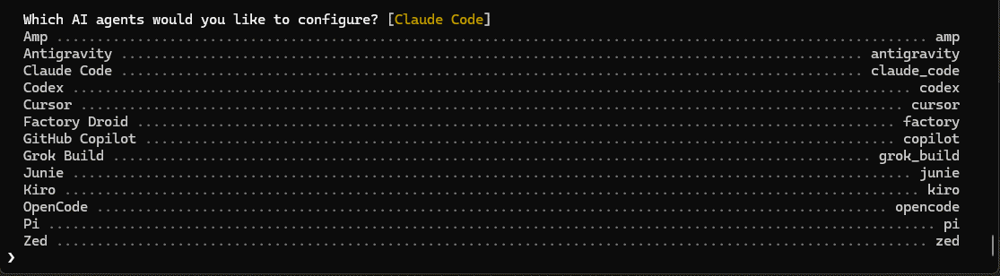

11. Жмя ENTER

12. В VSCode открыть папку PDF

13. 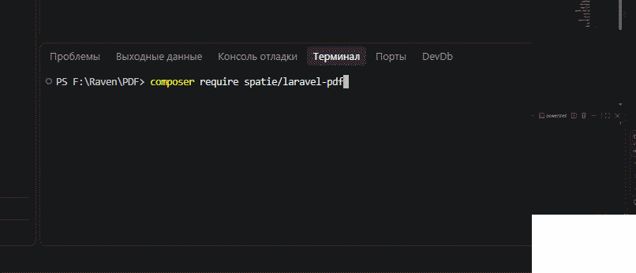

14. The Browsershot driver requires the spatie/browsershot package:

              _ composer require spatie/browsershot _

15. 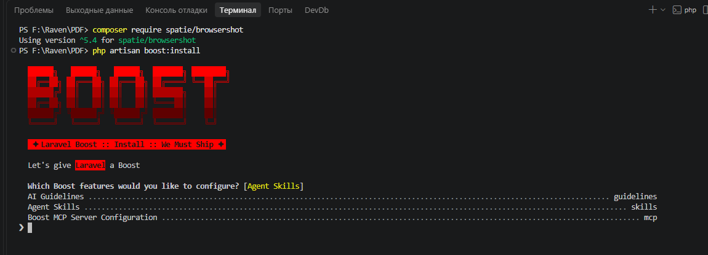

16. skills

17. 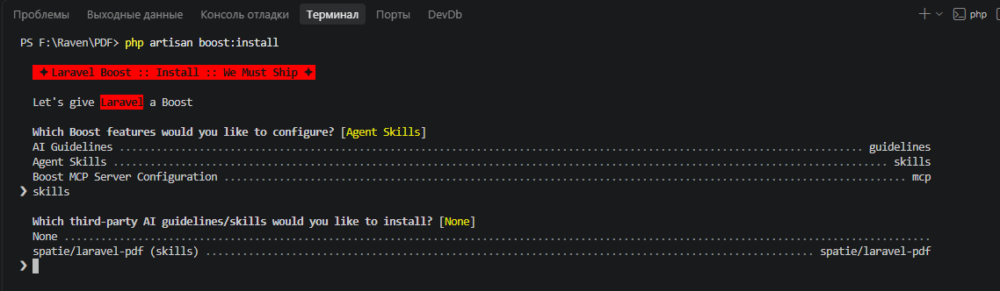

18. spatie/laravel-pdf (skills)

19. 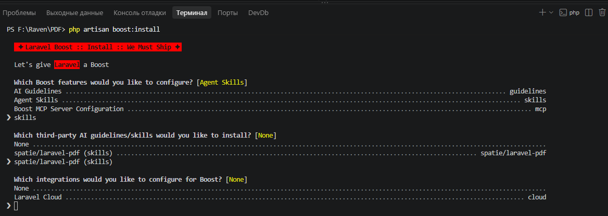

20. None

21. 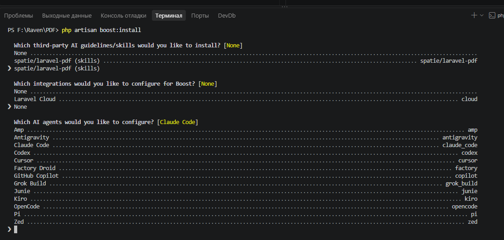

22. Жмя ENTER

23. 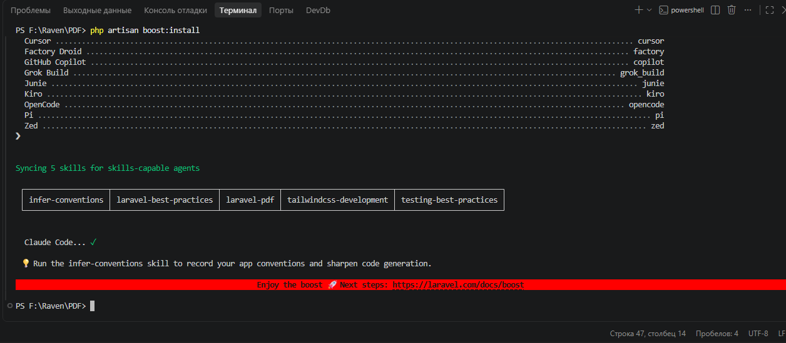

24.        _php artisan vendor:publish --tag=pdf-config_

25. Открываем F:\Raven\PDF\config\laravel-pdf.php

26. Проверяем driver:

27. 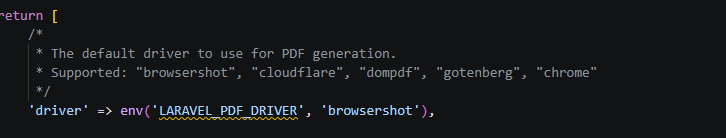

28. Проверяем browsershot:

29. 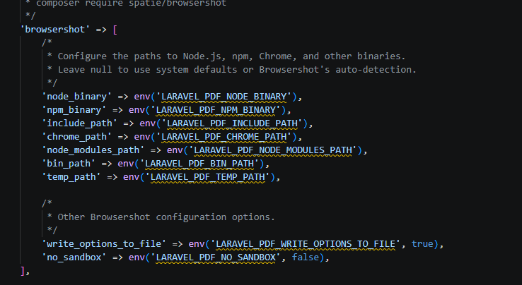

30. Работаем

P.S. Перед _ПЕРВЫМ_ запуском проекта не забудьте

npm install puppeteer

